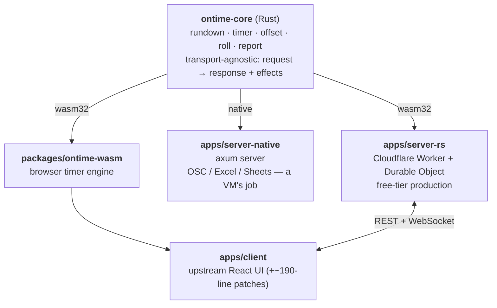

# ontime-rs

A Rust reimplementation of [Ontime](https://github.com/cpvalente/ontime) — the open-source live-event rundown and timer manager — rebuilt so it runs on **Cloudflare's free tier at zero cost**.

Upstream Ontime's backend is ~20,000 lines of TypeScript/Node. This fork ports its engine to a **single ~4,100-line Rust core** that compiles to three targets from one source:

- a **Cloudflare Worker** backed by a SQLite Durable Object — the 0-baht deployment,
- a **native `axum` server** — for everything a Worker structurally can't do,
- a **browser WASM module** — the timer engine runs client-side, drift-free.

One engine, every host.

> ### Credit & scope
> Ontime is designed and built by **[Carlos Valente](https://github.com/cpvalente) and contributors** ([GPLv3](https://www.gnu.org/licenses/gpl-3.0)). This repository is an **independent reimplementation of its backend** — not an official release and not affiliated with the project. Upstream's original README is preserved at **[README-upstream.md](README-upstream.md)**.
>
> The React client (`apps/client`) is upstream's, carried with ~190 lines of local patches. The reimplementation is the Rust backend and the shared timer engine.

## Why

- **0 baht to run.** Cloudflare Workers + Durable Objects have a genuine free tier: an idle Durable Object costs nothing and its storage survives code deploys. A whole live-event backend, hosted for free.
- **One core, many hosts.** All the scheduling and timer logic lives in `ontime-core` and is transport-agnostic — it takes a request and a project and returns a response plus a list of *effects*. The Worker and the native server are thin adapters that carry those effects out. Workers-vs-VM becomes a per-deployment choice, not a rewrite.
- **The timer runs in the browser too.** The same Rust engine is compiled to WASM and shipped to the client, which advances the countdown locally between server packets. The server sends only on change or heartbeat — and because both sides run identical code, they compute identical numbers. Zero drift.

## Architecture



The seam is an **`Effect`** enum: the core returns *what must happen* — persist, tell clients, reschedule — and each host decides *how*, because a Durable Object alarm and a `tokio` interval have nothing in common. Whenever behaviour lived in a host instead of the core, the other host silently lacked it — so the routing, the auth rule, the wake policy and the socket handling all moved into `ontime-core`, and the e2e suites run against **both** hosts to keep them in step.

## What works

Live on Cloudflare (Worker + Pages):

- **Rundowns** — CRUD with real timing: `linkStart`, `timeStrategy`, gaps, day offsets, delays; groups, clone, reorder, swap, renumber, batch edit; and **duplicate a whole rundown** with fresh ids, safe to reuse season over season.
- **Playback** — start / pause / stop / reload / load / add-time, end actions, and a **roll mode** that follows the wall clock (waits through gaps, joins an in-progress event part-way).
- **A shared WASM timer engine** — browser and server agree to the millisecond.
- **Runtime offset** — a full rundown-wide port of "ahead/behind schedule", not a single-event approximation.
- **Rooms** — one isolated project per room (`/r/<room>`), with **per-room password auth** over REST and WebSocket, settable from the UI, plus a room-creation gate.
- **A never-overwritten report archive** — once a show has actually run, its per-section timing is snapshotted permanently and denormalised, so it survives the rundown being edited or deleted, for year-over-year analysis.
- Project data, settings, view settings, custom fields, URL presets, CSS overrides.

## Repo layout

| Path | What it is |
|---|---|
| `packages/ontime-core` | **the reimplementation** — the portable Rust engine (~4,100 lines) |
| `apps/server-rs` | Cloudflare Worker adapter (~670 lines) — the 0-baht host |
| `apps/server-native` | `axum` adapter (~680 lines) — the native host |
| `packages/ontime-wasm` | browser bindings for the timer engine |
| `apps/client` | upstream's React UI + minimal patches for rooms and tokens |
| `apps/server`, `cli`, `electron`, … | upstream's original apps, kept as the porting reference |
| `.handovers/` | dated notes on each step, ending in [`011_roadmap.md`](.handovers/011_roadmap.md) |

## Testing

The port is pinned by **160 Rust unit tests** plus **13 end-to-end suites** (`apps/server-rs/tests/e2e`) that drive the real HTTP and WebSocket surface the client uses. Each suite was written in response to a real bug — a `200` with the wrong body, rooms leaking into each other, a timer that stopped ticking — and they run against both the Worker and the native server.

```bash
# unit tests
cargo test --manifest-path packages/ontime-core/Cargo.toml

# end-to-end against a local `wrangler dev`
apps/server-rs/tests/e2e/run.sh --start
```

## Build & deploy

```bash
./deploy-cloud.sh            # build + deploy the Worker and the client
./deploy-cloud.sh --worker   # Worker only
./deploy-cloud.sh --dry-run  # build everything, deploy nothing
```

One Rust core, compiled per target; the client is built with the Worker URL baked in via `VITE_WORKER_URL`. The script encodes the build order (the WASM engine must be built before the client) and guards against the mistakes that produce a silently broken deploy.

## Status

The [roadmap](.handovers/011_roadmap.md) tracks this in phases, grounded in measured cost rather than vibes. **Phases 0–3 are done** — a real show can be run from this without the desktop app. Remaining, in order of value:

1. **Custom views** — still a stub.
2. **The features a Worker structurally can't host** — OSC/automation, Excel, Google Sheets, project files (~4,500 lines that need a filesystem and open sockets). Unblocked by the native target; not yet built.

## License

GPLv3, inherited from [upstream Ontime](https://github.com/cpvalente/ontime). See [LICENSE](LICENSE).
